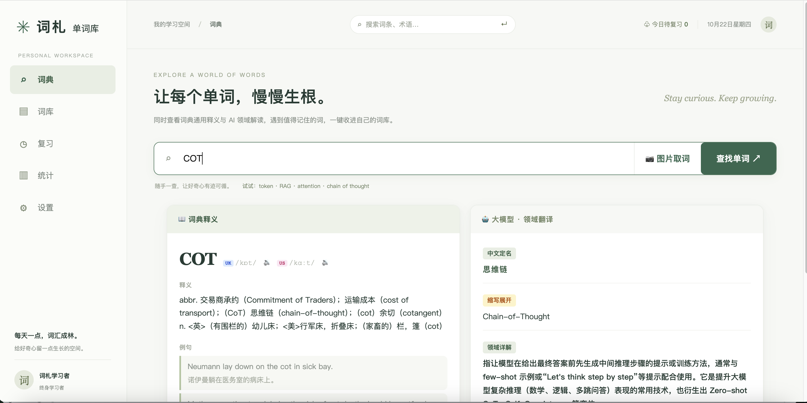
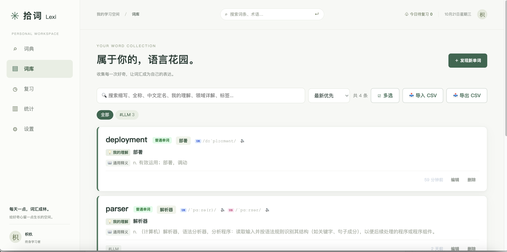
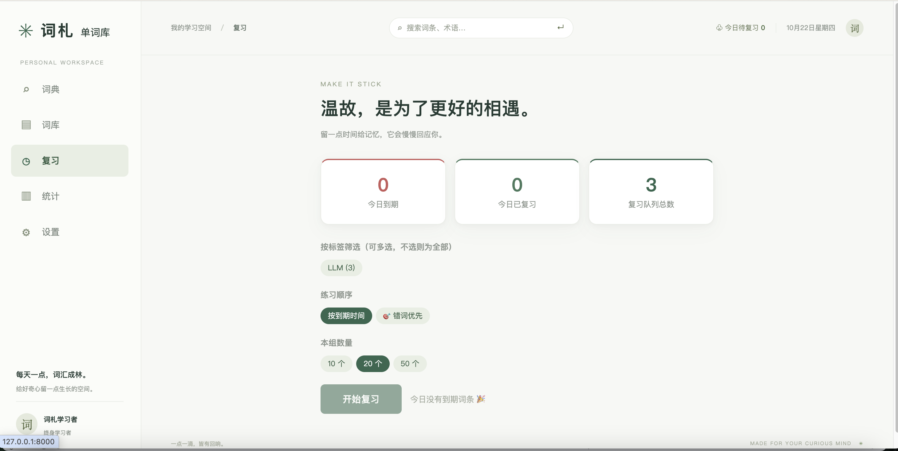
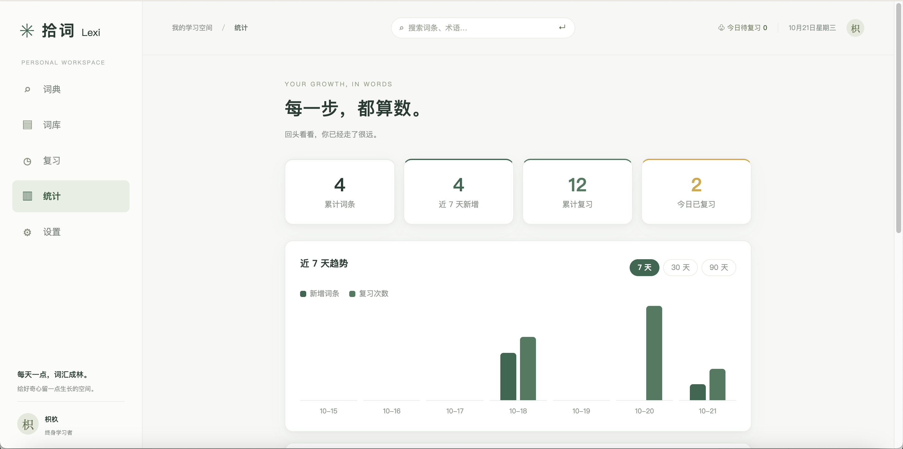

<div align="center">

# 词札单词库

**查得到 · 记得下 · 找得快**

面向 AI / 大模型从业者的英文术语记录本

[](https://github.com/ZhiJiu-An/cizha-vocab/releases/tag/v0.1.0)
[](https://www.python.org/)
[](https://fastapi.tiangolo.com/)
[](https://vuejs.org/)
[](backend/tests)
[](https://github.com/astral-sh/ruff)
[](LICENSE)

</div>

---

## 目录

- [为什么做这个](#为什么做这个)
- [界面展示](#界面展示)
- [功能特性](#功能特性)
- [技术栈](#技术栈)
- [快速开始](#快速开始)
- [配置](#配置)
- [使用流程](#使用流程)
- [API 概览](#api-概览)
- [数据与备份](#数据与备份)
- [项目结构](#项目结构)
- [开发与测试](#开发与测试)
- [Roadmap](#roadmap)
- [Contributing](#contributing)
- [License](#license)
- [Acknowledgements](#acknowledgements)

---

## 为什么做这个

读英文技术文档和论文时，很多词在通用语境和专业语境下含义完全不同。比如 `token`：

- 词典告诉你：`n. 代币；象征；凭证`
- 你真正需要的是：`词元 —— LLM 处理文本的最小单位`

词札把这两份答案放在同一页：左边查词典，右边让大模型按你的领域给出解读。查完一键收藏，之后用间隔重复复习，再用全局搜索随时找回来。

**核心流程**：`查词 → 双源对照 → 收藏 → 复习 → 统计`

---

## 界面展示

| 词典双栏查询 | 词库 |
|:---:|:---:|
|  |  |

| 复习翻卡 | 学习统计 |
|:---:|:---:|
|  |  |

---

## 功能特性

### 词典搜索

- 双栏结果：左栏有道词典（英/美音标、中文释义、双语例句），右栏大模型 SSE 流式翻译
- 五段式领域输出：中文定名 → 缩写全称 → 领域详解 → 领域例句 → 例句译文
- 本地优先：已在词库中的词直接展示你的笔记，默认跳过模型调用
- 图片取词：上传图片或 `Ctrl+V` 粘贴截图，识别原文并提取术语，支持整句与子词分别查询
- 音标点击发音：真人音频优先，失败自动回落浏览器 TTS

### 词库管理

- 卡片浏览、类型徽章、标签筛选、多字段关键词搜索
- 新建 / 编辑 / 详情 / 删除，删除后支持撤销
- 居中悬浮快速预览，不打断浏览
- 多选批量加标签、批量删除（单请求 + 单事务）
- CSV 导入导出，兼容旧版 10 / 11 列格式
- 复习队列开关、复习排期重置

### 间隔重复复习

- 六档间隔：1 / 2 / 4 / 7 / 15 / 30 天
- 3D 翻卡 + 三档自评：记住 / 模糊 / 忘记
- 到期队列、标签筛选、错词优先排序
- 错词本聚合历史「忘记」次数
- 到点学习提醒：页面后台走系统通知，前台走应用内提示

### 学习统计

- 单词总数、近 7 天新增、累计复习、今日已复习
- 标签分布 Top 8、1~365 天趋势（>31 天自动按周聚合）、六档分布
- 纯 CSS 图表，无额外图表依赖

### 模型配置

- 文本 / 视觉模型分角色管理，每类最多一个默认
- 新增、编辑、删除、设为默认、仅测试连通
- 保存前自动连通性测试，通过才写入
- 四套领域提示词预设（大模型 / 计算机 / 医学 / 金融）+ 自定义
- 提示词强制包含 `{word}` 与五段标记

---

## 技术栈

| 层 | 选型 |
|---|---|
| 后端 | FastAPI · SQLAlchemy 2 · SQLite |
| 前端 | Vue 3（`<script setup>`）· Vue Router · Vite · Axios |
| 词典 | 有道词典 jsonapi |
| 大模型 | OpenAI 兼容接口 · SSE 流式 |
| 测试 | Python 标准库 `unittest`（内存 SQLite 隔离） |
| 代码质量 | ruff · GitHub Actions |

---

## 快速开始

### 环境要求

- Python **3.10+**
- Node.js **20.19+ / 22.12+**（安装依赖和构建前端时需要）
- 无需安装数据库

### 一键安装与启动（推荐）

macOS / Linux：

```bash
git clone https://github.com/ZhiJiu-An/cizha-vocab.git
cd cizha-vocab

./setup.sh          # 创建 venv、安装前后端依赖、构建前端
# 编辑 backend/.env，填入 LLM_BASE_URL / LLM_API_KEY / LLM_MODEL
./start.sh          # 单端口启动并自动打开浏览器
```

Windows：双击 `setup.bat`，编辑 `backend\.env`，再双击 `start.bat`。

- `setup` 脚本会检查 Python / Node 版本，自动创建 `backend/venv`、安装后端依赖、执行 `npm install` 与 `npm run build`，首次运行时从 `.env.example` 生成 `backend/.env`
- 重复运行是安全的：已有的 `backend/venv` 会复用，`backend/.env` 不会被覆盖
- `start` 脚本发现前端未构建时会自动补建，**启动前先检查端口占用**（被占用时直接报错退出，不会让浏览器打开一个旧实例），后端能响应 `/api/health` 后才打开浏览器（可用 `CIZHA_NO_OPEN=1` 关闭自动打开）
- 换端口：`CIZHA_PORT=8001 ./start.sh`（Windows 设置环境变量 `CIZHA_PORT` 后运行 `start.bat`）

访问 <http://127.0.0.1:8000>。

#### 国内网络

`PyPI` / `npm` 官方源在国内可能非常慢（实测 PyPI 约 **6 kB/s**，清华镜像约 **516 kB/s**），
典型表现是安装日志里出现：

```
ERROR: Could not find a version that satisfies the requirement sqlalchemy>=2.0.0
       (from versions: none)
```

**这通常是下载超时，不是依赖写错。** 两个脚本都支持用环境变量切镜像（`pip` 与 `npm` 原生读取这两个变量）：

macOS / Linux：

```bash
PIP_INDEX_URL=https://pypi.tuna.tsinghua.edu.cn/simple \
npm_config_registry=https://registry.npmmirror.com \
./setup.sh
```

Windows（先设置变量再运行 `setup.bat`）：

```bat
set PIP_INDEX_URL=https://pypi.tuna.tsinghua.edu.cn/simple
set npm_config_registry=https://registry.npmmirror.com
setup.bat
```

### 手动安装（开发模式）

```bash
git clone https://github.com/ZhiJiu-An/cizha-vocab.git
cd cizha-vocab/backend

python3 -m venv venv
source venv/bin/activate        # Windows: venv\Scripts\activate

pip install -r requirements.txt
cp .env.example .env            # 填入 LLM_BASE_URL / LLM_API_KEY / LLM_MODEL

uvicorn app.main:app --reload --port 8000 --reload-exclude "data/*"
```

> `--reload-exclude "data/*"` 不可省略：SQLite 写入会触发 uvicorn 重载，可能中断正在提交的复习请求。

另开一个终端启动前端：

```bash
cd frontend
npm install
npm run dev
```

打开 <http://localhost:5173>，开发服务器会把 `/api` 代理到 `127.0.0.1:8000`。

首次启动会自动建表并执行幂等迁移。API 文档：<http://127.0.0.1:8000/docs>

### 构建与单端口托管

```bash
cd frontend
npm run build      # 产物输出到 frontend/dist
```

构建完成后不需要再启动 Vite：FastAPI 会自动托管 `frontend/dist`，`/` 返回页面、`/assets/*` 返回静态资源、其他非 API 路径回落到 `index.html`（适配 vue-router history 模式）。因此正式使用时只需要 `uvicorn` 一个进程；若后端在构建前已经启动，重启一次即可加载产物。

---

## 配置

### 环境变量

在 `backend/.env` 中配置（模板见 [.env.example](backend/.env.example)）：

| 变量 | 必填 | 说明 |
|---|:---:|---|
| `LLM_BASE_URL` | 是 | OpenAI 兼容接口地址 |
| `LLM_API_KEY` | 是 | 模型 API Key |
| `LLM_MODEL` | 是 | 默认文本模型名 |
| `LLM_VISION_MODEL` | 否 | 视觉模型名；未配置时图片取词返回明确提示 |
| `LLM_VISION_BASE_URL` | 否 | 留空回落到 `LLM_BASE_URL` |
| `LLM_VISION_API_KEY` | 否 | 留空回落到 `LLM_API_KEY` |
| `CIZHA_ALLOWED_ORIGINS` | 否 | CORS 白名单，逗号分隔 |
| `CIZHA_DB_PATH` | 否 | 覆盖 SQLite 数据库路径 |

视觉模型回落链：**运行时视觉配置 > `LLM_VISION_*` > 默认文本模型**。DeepSeek 官方 API 不支持图片输入，图片取词需要另配视觉服务。

### 运行时配置

除 `.env` 外，也可以在「设置 → 模型与提示词」中管理模型：

- 配置写入 `backend/data/llm_config.json`，优先级高于 `.env`，保存即生效
- `.env` 仅在配置文件不存在时用于首次初始化
- API Key 回显脱敏，保存时自动还原；文件含明文 Key，已被 `.gitignore` 排除

---

## 使用流程

1. **查词**：首页输入单词、短语或缩写，左右两栏同时返回词典释义与领域解读
2. **取词**：也可以上传截图，让视觉模型从图片中提取术语
3. **收藏**：点击「收藏」写入词库，自动映射定名、释义与双语例句
4. **复习**：新词默认当天到期，进入复习页翻卡自评
5. **回顾**：在统计页查看复习趋势、标签分布与最常忘记的词

---

## API 概览

完整定义与在线调试见 `http://127.0.0.1:8000/docs`。

| 方法 | 路径 | 说明 |
|---|---|---|
| GET | `/api/health` | 服务信息与版本号 |
| GET | `/api/dictionary/{word}` | 有道词典查询 |
| GET | `/api/translate/{word}` | 大模型领域翻译（SSE） |
| GET / POST | `/api/words` | 词条列表 / 新建 |
| GET / PUT / DELETE | `/api/words/{id}` | 详情 / 更新 / 彻底删除 |
| POST | `/api/words/bulk-delete` | 批量删除 |
| POST | `/api/words/bulk-tag` | 批量加标签 |
| POST | `/api/words/restore` | 撤销删除 |
| GET | `/api/words/lookup` | 按缩写精确查找 |
| POST / GET | `/api/words/batch` · `/api/words/export` | CSV 导入 / 导出 |
| GET | `/api/tags` | 标签聚合 |
| GET | `/api/review/overview` · `/due` · `/mistakes` | 复习概览 / 到期队列 / 错词本 |
| POST | `/api/review/{id}/answer` · `/reset` | 提交自评 / 重置排期 |
| GET | `/api/stats/summary` | 学习统计 |
| POST | `/api/ocr/extract` | 图片取词（≤10MB） |
| GET / POST / PUT / DELETE | `/api/llm/models` | 模型配置管理 |

---

## 数据与备份

| 数据 | 位置 |
|---|---|
| 词条、复习排期、复习日志 | `backend/data/cizha.db` |
| 模型配置（含明文 Key） | `backend/data/llm_config.json` |
| 偏好设置（昵称 / 口音 / 提醒） | 浏览器 localStorage |

- **完整备份**：直接复制 `backend/data/cizha.db`
- **CSV**：仅包含词条与当前复习进度，不含逐次复习历史；适合迁移词库，不等同于完整备份
- **删除语义**：删除词条会同时清理其复习日志；撤销删除恢复内容与当前排期，但累计复习次数归零

---

## 项目结构

```text
cizha-vocab/
├── backend/
│   ├── app/
│   │   ├── main.py            # 入口：CORS、迁移、路由注册
│   │   ├── models.py          # Word / ReviewLog
│   │   ├── schemas.py         # Pydantic 模型
│   │   ├── config.py          # 运行时模型配置
│   │   └── routes/            # words / dictionary / translate / review / stats / ocr / llm_config
│   ├── tests/                 # 202 个单元测试
│   └── data/                  # 运行时数据（gitignore）
├── frontend/
│   └── src/
│       ├── views/             # 词典 / 词库 / 复习 / 统计 / 设置 / 模型配置
│       ├── components/        # Phonetics / WordBadge / WordQuickView
│       ├── api/               # 接口封装
│       └── utils/             # toast / 偏好 / 发音
├── assets/screenshots/        # README 界面截图
├── setup.sh / setup.bat       # 一键安装依赖
├── start.sh / start.bat       # 一键启动（单端口 8000）
└── README.md
```

---

## 开发与测试

```bash
cd backend

# 单元测试（202 个）
./venv/bin/python -m unittest discover -s tests -t . -v

# 代码风格
ruff check app tests

# 前端构建验证
cd ../frontend && npm run build
```

- 每个测试用例使用独立的内存 SQLite，不会改动真实数据
- 测试入口会在导入应用前把 `CIZHA_DB_PATH` 指向临时文件
- CI 配置见 [.github/workflows/ci.yml](.github/workflows/ci.yml)：推送 `main` 或提交 PR 时自动执行 ruff + 全量测试

详细覆盖范围见 [backend/tests/README.md](backend/tests/README.md)。

---

## Roadmap

**已实现**：双源查询、词库 CRUD、CSV、六档复习、错词本、统计、模型列表与提示词、图片取词、发音与提醒。

**暂不在范围内**：

- 账号体系 / 多用户
- 云部署与多端同步
- 系统级截图取词（受浏览器能力限制）
- 移动端 App
- 中英双向词典

欢迎通过 Issue 讨论新的方向。

---

## Contributing

环境搭建、代码结构、提交规范与 PR 要求的完整说明见 [CONTRIBUTING.md](CONTRIBUTING.md)。简要流程：

1. Fork 仓库并创建分支：`feat/xxx`、`fix/xxx`
2. 保持提交信息遵循 `feat:` / `fix:` / `docs:` / `style:` 前缀
3. 提交前确保 `ruff check app tests` 与全量单元测试通过
4. 发起 Pull Request，说明改动动机与验证方式

如果是较大的功能调整，建议先开 Issue 对齐方案，避免重复劳动。安全问题请按 [SECURITY.md](SECURITY.md) 私下报告，不要公开提 Issue。版本变更记录见 [CHANGELOG.md](CHANGELOG.md)。

---

## License

本项目基于 [Apache License 2.0](LICENSE) 开源。

概要：可自由使用、修改与分发（包括商用），分发时须保留版权与许可声明、标注修改之处；贡献者同时授予专利许可；不授予商标使用权。

---

## Acknowledgements

- [FastAPI](https://fastapi.tiangolo.com/) · [SQLAlchemy](https://www.sqlalchemy.org/) · [Vue](https://vuejs.org/) · [Vite](https://vite.dev/)
- 词典数据来自 [有道词典](https://dict.youdao.com/)
- 大模型能力通过任意 OpenAI 兼容接口接入
- 界面灵感来自自然绿主题设计稿（`demo.html` / `demo-dict.html`）
